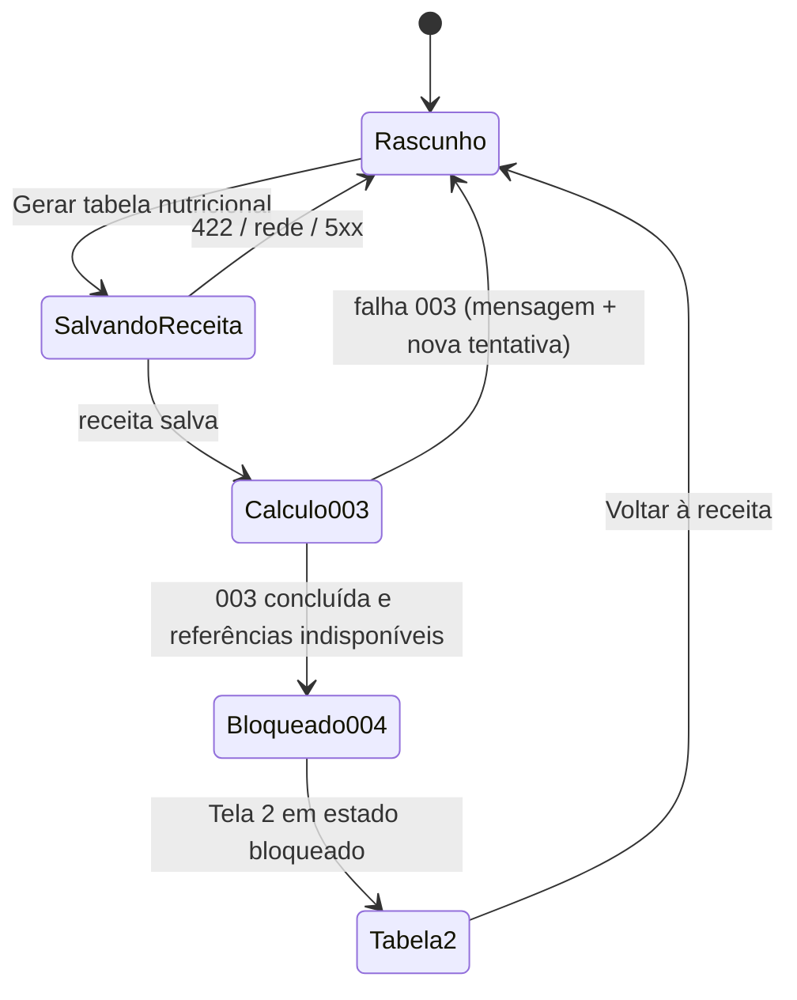

# Data Model — Feature 008

A Feature 008 **não cria nem altera tabelas, models ou migrations**. Este documento descreve (1) as leituras permitidas no backend e (2) o estado transitório no cliente.

## 1. Leituras somente leitura no backend

| Fonte | Uso | Acesso |
|---|---|---|
| `nutrients` (`Nutrient`: `id`, `name`, `unit`) | Mapeamento dos campos da Tela 4 (FR-022/031) | Eloquent `select`, nome+unidade exatos |
| `declared_nutrition_calculations` (`DeclaredNutritionCalculation`) | Route-model binding da Tela 3 (existência) | Leitura; dados exibidos vêm de `GET /api/declared-nutrition-calculations/{id}` |
| `recipes` (`Recipe`) | Route-model binding da Tela 2 (existência) | Leitura |

Mapeamento de campos da Tela 4 (nome e unidade exatos):

| Campo da UI | `name` | `unit` | Estado |
|---|---|---|---|
| Energia (kcal) | Energia | kcal | disponível se exatamente 1 registro |
| Carboidratos (g) | Carboidrato | g | idem |
| Proteínas (g) | Proteína | g | idem |
| Gorduras totais (g) | Lipídeos | g | idem |
| Gorduras saturadas (g) | Ácidos graxos saturados | g | idem |
| Fibra alimentar (g) | Fibra alimentar | g | idem |
| Sódio (mg) | Sódio | mg | idem |
| Açúcares totais / Açúcares adicionados / Gorduras trans | — | — | **sempre indisponível** (sem suporte no backend atual) |

Resultado do mapper (por campo): `{field, label, unit, nutrientId|null, available: bool, reason|null}`; `reason ∈ {NOT_FOUND, AMBIGUOUS, UNSUPPORTED}`.

## 2. Estado no cliente (`sessionStorage`)

### RecipeDraft (`rotulonutri.recipeDraft`)
| Campo | Tipo | Observação |
|---|---|---|
| `name` | string | → `name` |
| `productType` | `"SOLID"` \| `"LIQUID"` | → `yield_unit` `g`/`ml` |
| `yieldValue` | string decimal | → `yield_value` |
| `portionValue` | string decimal | **somente local** (FR-029) |
| `householdMeasure` | string | **somente local** |
| `ingredients[]` | `{foodId, name, source, quantity}` | `quantity` string decimal; `position` = índice+1 ao enviar |
| `recipeId` | int \| null | após `POST /api/recipes` |
| `unsavedNotice` | string \| null | aviso de itens não enviados |

Regras: `quantity` > 0 para ser enviada; vazio ≠ 0; vírgula normalizada para ponto; sem notação científica.

### StageReport (`rotulonutri.stageReport`)
`{recipeId, stages: [{stage, state, cause, resourceId?}]}` com `stage ∈ RECIPE_SAVED | CALC_003 | SERVING_004 | DECLARED_005` e `state ∈ DONE | FAILED | BLOCKED | SKIPPED`. Não contém valores nutricionais.

### ManualFoodForm (somente em memória na Tela 4)
`name`, `source`, `sourceCode`, `evidenceReference`, `evidenceSource`, `registeredBy`, `registeredOn`, `referenceUnit = "g"` (fixo), `nutrients[]` `{nutrientId, status, amountValue|null}`; nutriente sem estado selecionado é omitido.

## 3. Transições de estado

