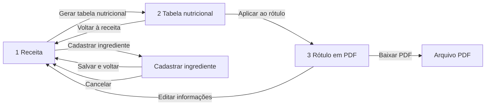

# Feature Specification: Frontend do Protótipo RótuloNutri

**Feature ID**: `008-frontend-prototype-ui`
**Feature Branch**: `frontend-` (branch atual do repositório)
**Created**: 2026-11-22
**Updated**: 2026-11-26 (ID único da feature, status de implementação e compatibilidade com Features 001–007)
**Status**: Specify, Clarify, Plan e Tasks concluídos; implementação em andamento, com validações finais pendentes.
**Constitution**: 2.0.0
**Referência visual obrigatória**: `docs/referencias/Rotulagem Nutricional – Protótipo.pdf` (4 páginas, exportadas em `docs/referencias/pagina-01.png` a `pagina-04.png`)
**Input**: "Especificar o frontend do protótipo aprovado do RótuloNutri, cruzando-o com o backend Laravel existente (Features 001–007), sem alterar backend ou funcionalidades existentes e sem inventar funcionalidades."

> **Numeração**: `007-added-sugars-formulation` já existe. Para evitar conflito de identificadores, esta feature usa `008-frontend-prototype-ui`. O diretório de especificação é `specs/008-frontend-prototype-ui/`.

## 0. Diretriz principal (decisão do diretor)

A Feature 008 implementa **exclusivamente a interface frontend** do protótipo dentro da aplicação Laravel existente. **O frontend se adapta integralmente ao backend atual.** É proibido alterar, complementar, contornar ou modificar o backend para a interface funcionar.

**Não alterar**: Models, Migrations, Controllers existentes, Services existentes, rotas da API existentes, contratos de requisição/resposta, regras de validação, cálculo nutricional, regras regulatórias ou artefatos das Features 001–007.

**Não criar**: endpoints de API, tabelas, campos, identificadores, nutrientes, regras de negócio ou funcionalidades inexistentes.

**Permitido** (apresentação): rotas web novas de apresentação, controllers de apresentação, views Blade, componentes Blade, CSS (Tailwind 4 já instalado) e JavaScript Vanilla via Vite. Controllers de apresentação MAY ler dados já existentes (por exemplo, modelo `Nutrient`) por meio de Eloquent **somente leitura**, sem alterar models, migrations ou contratos.

Requisito que dependa de capacidade inexistente no backend é classificado como **indisponível** ou **bloqueado**; esta especificação não propõe nenhuma alteração de backend para contorná-lo.

## 1. Análise do protótipo (PDF)

### 1.1 Identidade e estrutura comuns (todas as páginas)

| Elemento | Descrição observada |
|---|---|
| Barra lateral escura (verde-escuro) | Logotipo textual "Rótulo**Nutri**" (sufixo em verde-claro); itens "Receitas" (ativo, destacado em verde), "Rótulos", "Configurações" |
| Cabeçalho da página | Título grande + subtítulo "Base de dados: Tabela TACO" |
| Indicador de etapas (páginas 1–3) | 3 pílulas: "1 Receita", "2 Tabela nutricional", "3 Rótulo em PDF"; a etapa atual é preenchida em verde-escuro |
| Estilo | Fundo claro esverdeado, cartões brancos arredondados com borda fina, campos com fundo cinza-claro, botão primário verde-escuro, botão secundário com contorno verde, tipografia sans-serif geométrica, tabela nutricional com moldura preta/verde-escuro |
| Placeholders | Textos entre colchetes (`[Nome da receita]`, `[0]`, `[ex.: 1 fatia]`) são conteúdo de exemplo do protótipo, não rótulos reais |

### 1.2 Tela 1 — "Cadastro de Receita" (`pagina-01.png`)

- **Cartão "Informações da receita"**: *Nome da receita*; seleção exclusiva *Tipo do produto* — "Sólido ou semissólido · Valores por 100 g" (padrão) e "Líquido · Valores por 100 ml"; *Peso final da receita (g)*, *Porção (g)* e *Medida caseira* (placeholder "ex.: 1 fatia").
- **Cartão "Ingredientes e quantidades"**: *Buscar ingrediente* ("Digite para pesquisar na tabela TACO"); lista de resultados com a etiqueta de origem à direita ("TACO") e a ação final "Não encontrou? Cadastrar ingrediente manualmente"; linhas de ingredientes com nome, **−**, campo de quantidade, **+**, sufixo "g", "auto kcal" e **×**; barra escura "Total dos ingredientes [0] g"; caixa tracejada "Ingrediente não está no banco de dados? Cadastre manualmente em uma tela separada." com botão "+ Cadastrar novo ingrediente".
- **Ação principal**: "Gerar tabela nutricional".

### 1.3 Tela 2 — "Tabela Nutricional" (`pagina-02.png`)

- **Tabela "INFORMAÇÃO NUTRICIONAL"**: "Porções por embalagem: [0] · Porção: [0 g]"; colunas **100 g**, **Porção**, **%VD\***; linhas: Valor energético, Carboidratos, Açúcares totais, Açúcares adicionados, Proteínas, Gorduras totais, Gorduras saturadas, Gorduras trans, Fibra alimentar, Sódio; rodapé "*% Valores Diários de referência". Células "—" quando sem dados.
- **Painel "Modelo do cliente"**: "Vertical (padrão)" (selecionado), "padrão", "[10 pt]"; botões "Aplicar ao rótulo" e "Voltar à receita".

### 1.4 Tela 3 — "Montagem do Rótulo" (`pagina-03.png`)

- **Pré-visualização**: "[Nome do produto]", "Ingredientes: [lista de ingredientes]", tabela nutricional (10 linhas, 3 colunas), "[Lote · Validade · Peso líquido · Contato]".
- **Painel "Arquivo para impressão"**: *Tamanho do rótulo* ("ex.: 10 × 15 cm"), *Formato* ("PDF"), *Nome do arquivo* ("[nome-do-produto].pdf"); "Baixar PDF" e "Editar informações".

### 1.5 Tela 4 — "Cadastrar Ingrediente" (`pagina-04.png`)

- Trilha "Receita › Ingredientes"; subtítulo "Ingrediente não encontrado na tabela TACO".
- **"Dados do ingrediente"**: *Nome do ingrediente*; *Fonte do dado (opcional)*; *Valores informados por* — "100 g" (padrão) ou "100 ml".
- **"Informação nutricional"** (grade 3 colunas): Energia (kcal), Carboidratos (g), Açúcares totais (g), Açúcares adicionados (g), Proteínas (g), Gorduras totais (g), Gorduras saturadas (g), Gorduras trans (g), Fibra alimentar (g), Sódio (mg).
- **Cartão "Como funciona"**; ações "Salvar no banco e voltar à receita" e "Cancelar".

### 1.6 Fluxo inferido do protótipo

**Fluxo efetivamente alcançável com o backend atual** (ver 2.3 e CQ-002): Receita → salvar receita → Feature 003 → **interrupção na Feature 004** com mensagem da etapa bloqueada → Tela 2 em estado "bloqueado" (tabela sem valores). A Tela 3 só é alcançável quando houver uma execução válida da Feature 005 disponível; este protótipo não cria nem simula tal execução.

## 2. Cruzamento com o backend (estado real)

### 2.1 Capacidades existentes (Features 001–007)

| Endpoint | Função | Observações relevantes |
|---|---|---|
| `GET /api/foods?q=` | Busca alimento por nome | `q` obrigatório; retorna `id`, `name`, `source`, `category?`, `source_code?`, nutrientes (`id`, `name`, `unit`, `amount_value`, `status`); sem paginação; exclui manuais inativos |
| `POST /api/recipes`, `PUT/GET /api/recipes/{id}` | Receita | `name`, `yield_value`, `yield_unit` (`g`\|`ml`), `ingredients[]` (`food_id`, `quantity` string decimal > 0, `unit` somente `g`, `position` distinto ≥ 1); sem listagem nem exclusão |
| `POST /api/recipes/{id}/nutrition-calculations`, `GET /api/nutrition-calculations/{id}` | Feature 003 | Cálculo exato (razões `numerator/denominator`); não exige dados além da receita |
| `POST /api/nutrition-calculations/{id}/serving-daily-value-calculations`, `GET …/{id}` | Feature 004 | Exige `portion {value, unit, household_measure}`, `portion_authorization_id`, `regulatory_profile_id` |
| `POST /api/serving-daily-value-calculations/{id}/declared-nutrition-calculations`, `GET …/{id}` | Feature 005 (**intocável**) | Exige `regulatory_declaration_profile_id`; retorna `is_label_ready`, `label_readiness_causes` |
| `POST /api/manual-foods`, `GET/PUT /api/manual-foods/{food}`, `PATCH …/status` | Feature 006 | Ver M-26 a M-33 |

Fatos adicionais: nenhuma rota exige autenticação; `routes/web.php` contém apenas `welcome`; assets em `resources/views`, `resources/js/app.js`, `resources/css/app.css` (Vite + Tailwind 4 instalados); erros em `api/*` retornam JSON (422 com `errors`).

### 2.2 Matriz protótipo × backend (consolidada com as decisões)

Legenda: **S** suportado · **P** parcial/condicionado · **I** indisponível (sem suporte; exibido explicitamente como indisponível) · **B** bloqueado (depende de referência/regra que o backend não disponibiliza).

| # | Elemento do protótipo | Backend | Classe | Decisão |
|---|---|---|---|---|
| M-01 | Nome da receita | `recipes.name` | S | — |
| M-02 | Tipo do produto | `yield_unit` (`g`\|`ml`) | S | CQ-001: sólido = `g`, líquido = `ml` |
| M-03 | Peso/Volume final | `yield_value` + `yield_unit` | S | CQ-001: rótulo "Peso final (g)" ou "Volume final (ml)" |
| M-04 | Porção | Só existe no pedido da Feature 004 (não persiste na receita) | P | CQ-001: unidade acompanha `yield_unit`; valor mantido localmente na sessão de edição; só é enviado se a Feature 004 puder ser executada (hoje bloqueada) |
| M-05 | Medida caseira | `portion.household_measure` (Feature 004) | P | Mesma condição de M-04 |
| M-06 | Busca na TACO | `GET /api/foods?q=` | S | Retorna também manuais ativos |
| M-07 | Etiqueta de origem | `source` | S | Exibir o valor retornado |
| M-08 | Quantidade g com −/+ | `quantity` string decimal > 0, `unit = g` | S | CQ-004 |
| M-09 | "auto kcal" | Cálculo no cliente é vedado; contribuição por ingrediente só existe após a Feature 003 | I | Exibir indisponibilidade, nunca número |
| M-10 | Total dos ingredientes | Sem endpoint | P | CQ-005: soma informativa local |
| M-11 | Remover ingrediente | `PUT` com lista completa | S | Edição local até salvar |
| M-12 | "Gerar tabela nutricional" | Receita (S) → Feature 003 (S) → Feature 004 (**B**) → Feature 005 (**B**) | P | CQ-002 |
| M-13 | Valor energético | Matriz ENE/MAP-001 | B | Exibir o que a Feature 005 retornar; sem ela, "—" |
| M-14 | Carboidratos, Proteínas, Gorduras totais, Gorduras saturadas, Fibra, Sódio | MAP-002, 005, 006, 007, 009, 010 | B | Valores somente via Feature 005 |
| M-15 | Açúcares totais | MAP-003 sem `nutrient_id` | I | — |
| M-16 | Açúcares adicionados | MAP-004 indisponível | I | — |
| M-17 | Gorduras trans | MAP-008 sem total | I | — |
| M-18 | Colunas 100 g / Porção / %VD | Feature 005 | B | Apenas a partir de uma execução 005 |
| M-19 | Porções por embalagem | Sem campo/endpoint | I | CQ-006: "—" |
| M-20 | Painel "Modelo do cliente" | Sem entidade/campos | I | CQ-007: apenas visual |
| M-21 | Nome do produto, ingredientes, lote, validade, peso líquido, contato | Sem campos (exceto `recipes.name`) | I | Placeholders do protótipo |
| M-22 | Tamanho do rótulo, formato, nome do arquivo | Sem entidade | I | Visual, sem efeito |
| M-23 | "Baixar PDF" | Sem exportação (FR-014 da Feature 005 a exclui) | I | Desabilitado e explicado |
| M-24 | Menu "Rótulos" e "Configurações" | Sem listagem/configurações | I | Visíveis como no protótipo, indisponíveis |
| M-25 | Voltar à receita / Editar informações | Navegação local + `PUT /api/recipes/{id}` | S | Dados preservados |
| M-26 | Tela 4 — nome | `name` obrigatório, não vazio | S | — |
| M-27 | Tela 4 — "Fonte do dado" | `source` **obrigatório**, ≠ `TACO`; além de `source_code`, `evidence_reference`, `evidence_source`, `registered_by`, `registered_on` (`Y-m-d`) | S | CQ-003: campos adicionais exibidos |
| M-28 | Tela 4 — 100 g | `reference_unit = g` | S | — |
| M-29 | Tela 4 — 100 ml | `reference_unit` só aceita `g` | I | Opção desabilitada com explicação |
| M-30 | Energia (kcal), Carboidratos, Proteínas, Gorduras totais, Gorduras saturadas, Fibra, Sódio | `nutrients[]` com `nutrient_id`, `status`, `amount_value` | S | CQ-003 |
| M-31 | Açúcares totais, Açúcares adicionados, Gorduras trans | Sem `nutrient_id` | I | Campos desabilitados com explicação |
| M-32 | Status qualitativo por nutriente | `EXACT`, `TRACE`, `NA`, `ABSENT`, `REEVALUATION` | S | CQ-003: seletor exposto por campo |
| M-33 | Salvar / Cancelar | `POST /api/manual-foods` (201) / navegação local | S | CQ-003 |

### 2.3 Lacunas e bloqueios (sem proposta de alteração de backend)

- **GAP-01 — Referências regulatórias não disponibilizadas.** `portion_authorization_id`, `regulatory_profile_id` e `regulatory_declaration_profile_id` são obrigatórios nas Features 004/005, mas não há endpoint de consulta nem mecanismo documentado de disponibilização. **Bloqueio**: a cadeia termina na Feature 003; a Feature 004 e a 005 ficam bloqueadas. Nenhum identificador é criado, fixado, inferido ou mockado.
- **GAP-02 — Cadastro manual**: 100 ml, açúcares totais, açúcares adicionados e gorduras trans sem suporte (M-29, M-31).
- **GAP-03 — Porções por embalagem** (M-19).
- **GAP-04 — Modelo/layout/tamanho de fonte/impressão** (M-20, M-22).
- **GAP-05 — Dados de rótulo** (M-21).
- **GAP-06 — Exportação PDF/PNG** (M-23).
- **GAP-07 — "Rótulos" e "Configurações"** (M-24).
- **GAP-08 — "auto kcal" ao vivo** (M-09).
- **GAP-09 — Estados qualitativos e causas**: ausentes do protótipo, mas obrigatórios na apresentação (FR-013, FR-014).

## 3. Clarificações — todas resolvidas (decisão do diretor, 2026-11-22)

| ID | Decisão | Requisitos afetados |
|---|---|---|
| **CQ-001** | Tipo do produto = `yield_unit`: sólido/semissólido `g`, líquido `ml`. Rendimento via `yield_value` + `yield_unit`, sem novo campo. Unidade da porção acompanha a do rendimento (validação da Feature 004). Rótulos dinâmicos: "Peso final (g)"/"Volume final (ml)" e "Porção (g)"/"Porção (ml)". Ingredientes sempre em `g`. Nenhuma conversão g ↔ ml no frontend. | FR-005, FR-007 |
| **CQ-002** | Usar exclusivamente identificadores regulatórios efetivamente disponibilizados pelo backend; não criar, inventar, gerar, fixar nem preencher manualmente `portion_authorization_id`, `regulatory_profile_id` ou `regulatory_declaration_profile_id`, nem simular sua existência. Fluxo: (1) salvar receita; (2) executar a Feature 003 conforme os dados disponíveis; (3) prosseguir para a 004 somente com os identificadores obrigatórios efetivamente disponíveis; (4) prosseguir para a 005 somente com os dados exigidos pelo contrato. Se a cadeia não puder continuar, interromper com mensagem clara da **etapa bloqueada e sua causa**. Nunca apresentar tabela final como concluída sem execução válida da Feature 005. Sem valores fictícios, IDs fixos, mocks ou resultados simulados. A indisponibilidade **não impede** salvar a receita quando válida. | FR-010 a FR-016 |
| **CQ-003** | Tela 4 respeita integralmente a Feature 006, mesmo com campos além do protótipo: `name`, `source`, `source_code`, `evidence_reference`, `evidence_source`, `registered_by`, `registered_on`. Nenhum obrigatório é preenchido silenciosamente, inventado ou omitido (inclusive data e responsável). `source` ≠ `TACO`. `reference_unit` somente `g`; "100 ml" visível porém indisponível com explicação. Nutrientes somente com `nutrient_id` existentes e suportados; açúcares totais, açúcares adicionados e gorduras trans indisponíveis com indicação de ausência de suporte. Cada nutriente respeita um estado permitido (`EXACT`, `TRACE`, `NA`, `ABSENT`, `REEVALUATION`); preservar diferença entre valor, ausência e estado qualitativo; campo vazio nunca vira zero; valores nos limites/formatos da validação da Feature 006. Envio exclusivamente por `POST /api/manual-foods`. Após `201`, retornar à receita preservando dados não salvos e permitindo pesquisar o ingrediente cadastrado. | FR-019 a FR-023 |
| **CQ-004** | Quantidade: string decimal positiva, `unit = g`, `position` inteiro sequencial distinto, valores > 0. Edição manual decimal. −/+ são controles locais de edição (sem regra nutricional nem chamada ao servidor); incremento de 1 g; decremento nunca resulta em valor ≤ 0 (no limite, o usuário edita o campo ou remove o ingrediente). Entrada normalizada para ponto decimal, sem notação científica. Sem cálculos nutricionais. | FR-007 |
| **CQ-005** | Total dos ingredientes = soma informativa das quantidades digitadas; identificado como "total informativo dos ingredientes"; não é o rendimento, não substitui `yield_value`, não é usado em cálculo nem enviado ao backend, não altera dados persistidos. O rendimento é informado separadamente. | FR-008 |
| **CQ-006** | Sem campo/endpoint de embalagem no backend: nada calculado, deduzido ou estimado. A linha mantém a estrutura do protótipo com "—" (ou indicação de indisponibilidade) para porções por embalagem. A porção exibida é exclusivamente a efetivamente utilizada na execução da Feature 004; o rendimento nunca é usado para deduzir porções. | FR-015 |
| **CQ-007** | Painel preserva aparência e estrutura do protótipo. "Vertical (padrão)", "padrão" e "[10 pt]" permanecem como elementos visuais, sem persistência nem efeito regulatório. "Aplicar ao rótulo" não gera, altera nem persiste modelo. "Voltar à receita" funciona e preserva os dados em edição. | FR-016, FR-018 |
| **CQ-008** | Tudo dentro do Laravel: Blade, rotas web (existentes ou novas de apresentação, sem alterar contratos da API), controllers de apresentação/integração, Services existentes quando aplicável, JavaScript Vanilla via Vite, CSS/Tailwind 4 já instalados (compatível com a Constituição 2.0.0 por já constar em `package.json`). Proibidos: frontend separado, SPA, React, Vue, Next.js, backend paralelo, nova API, nova camada de regras de negócio no cliente, dependências sem aprovação. Comunicação somente por endpoints existentes. A interface não duplica regras de validação, cálculo, arredondamento, conversão ou regulatórias do servidor. | FR-004, FR-024 a FR-027, NFR-007 |

### Diretrizes complementares (aprovadas)

1. O backend é a fonte única da verdade; o frontend consome e apresenta sem alterar significados.
2. `null` permanece `null`, exibido como "—" com acesso à causa.
3. `TRACE`, `NA`, `ABSENT`, `REEVALUATION` nunca viram zero.
4. Valores numéricos apresentados sem arredondar nem alterar precisão.
5. O frontend não calcula energia, macronutrientes, %VD nem qualquer resultado nutricional.
6. `is_label_ready` e `label_readiness_causes` são apresentados exatamente como retornados pela Feature 005; se `false`, informar que o resultado não está apto à rotulagem e listar as causas.
7. Funcionalidades sem suporte permanecem visivelmente indisponíveis, sem simulação.
8. Erros 422 nos respectivos campos com as mensagens da API; erros de rede/5xx com mensagem compreensível e nova tentativa.
9. Preservar contratos, arquivos e responsabilidades das Features 001–007.
10. Fidelidade visual às quatro páginas do protótipo, sem novas telas ou funcionalidades.
11. Nenhum arquivo de backend, migration ou da Feature 005 é alterado.

### Decisões complementares aprovadas (2026-11-22)

1. **Mapeamento de nutrientes (FR-022, FR-031)**: controller de apresentação, consulta somente leitura à tabela `nutrients`, relação por nome e unidade; sem `nutrient_id` fixo, sem criar/modificar registros, sem presumir nutrientes inexistentes; correspondência ausente ou ambígua = campo indisponível, sem escolha arbitrária.
2. **Porção e medida caseira (FR-029)**: somente estado local; sem campos, colunas ou persistência no backend; enviados à Feature 004 apenas quando todos os requisitos dessa integração estiverem disponíveis; sem simulação enquanto bloqueada.
3. **Resultados da Feature 003 (FR-030)**: não preenchem células da tabela quando exigirem conversão ou cálculo no cliente; a interface mostra apenas andamento das etapas, estados da API e mensagens de erro; células permanecem "—" ou informativas; sem frações convertidas, cálculos, arredondamentos, estimativas ou valores fictícios.
4. **Preservação do backend**: nada nas Features 001–007 é alterado (migrations, tabelas, Models, regras, endpoints, contratos, cálculos). A Feature 008 se adapta ao backend atual.

Revisão de compatibilidade das decisões: a leitura de `nutrients` (Feature 001, somente leitura) e o uso de nome+unidade são compatíveis com a base importada (`nutrients.csv` possui `Energia` em `kcal` e `kJ`, distinguíveis pela unidade); nenhuma incompatibilidade nova com as Features 001–007 foi encontrada. A ambiguidade potencial (mais de um registro com o mesmo nome e unidade) é tratada por FR-031.

### Verificação de compatibilidade (Features 001–007 e Constituição 2.0.0)

| Verificação | Resultado |
|---|---|
| Princípio I (Não Invenção) | Compatível: nenhuma regra, ID ou campo inventado; lacunas classificadas I/B |
| Princípio II (Stack) | Compatível: Laravel + Blade + Vite + Tailwind 4 já instalado; sem dependências novas |
| Princípio III (Arquitetura) | Compatível: cliente apenas apresenta; regras permanecem em Services |
| Princípio IV (Motor de cálculo) | Compatível: nenhum cálculo/arredondamento no cliente (total informativo de quantidades digitadas não é cálculo nutricional) |
| Princípio V (TACO / zero ≠ ausente) | Compatível: estados qualitativos preservados; campo vazio nunca enviado como 0 |
| Princípio VI (Regulatório) | Compatível: tabela final só com Feature 005; bloqueios exibidos |
| Autoridade administrativa | Compatível: pendências isoladas, resultados parciais nunca apresentados como aptos |
| Feature 001/002 | Busca e receita usadas conforme contrato (`unit = g`, `yield_unit` g/ml) |
| Feature 003 | Executável com a receita salva |
| Feature 004 | Bloqueada por GAP-01; contrato respeitado (`portion.unit` = `yield_unit`) |
| Feature 005 | Somente leitura de contrato; nunca alterada; bloqueada por GAP-01 |
| Feature 006 | Contrato integral respeitado (campos obrigatórios, `g`, sem `TACO`) |

## 4. User Scenarios & Testing *(mandatory)*

### User Story 1 — Montar e salvar a receita (Priority: P1)
Como usuário, quero informar nome, tipo, rendimento, porção e medida caseira, pesquisar ingredientes na TACO e definir quantidades, para salvar a receita.

**Independent Test**: Preencher a Tela 1, buscar "arroz", adicionar dois ingredientes, salvar e reabrir a receita pelo `id`.

**Acceptance Scenarios**:
1. **Given** a Tela 1, **When** o usuário seleciona "Líquido", **Then** os rótulos mudam para "Volume final (ml)" e "Porção (ml)", `yield_unit` é `ml` e os ingredientes continuam em "g".
2. **Given** a Tela 1, **When** o usuário digita um termo, **Then** a lista exibe os alimentos de `GET /api/foods` com a origem (`source`) e a ação final "Não encontrou? Cadastrar ingrediente manualmente".
3. **Given** um ingrediente adicionado, **When** o usuário aciona "+", **Then** a quantidade aumenta 1 g; **When** aciona "−" e o resultado seria ≤ 0, **Then** a ação não é executada.
4. **Given** quantidade digitada "1,5", **When** a receita é enviada, **Then** `quantity` é a string `"1.5"`.
5. **Given** ingredientes informados, **Then** "Total informativo dos ingredientes" mostra a soma e não altera `yield_value`.
6. **Given** resposta 422, **Then** cada erro aparece no campo correspondente com a mensagem da API.
7. **Given** a cadeia bloqueada (GAP-01), **When** a receita é válida, **Then** ela é salva mesmo assim.

### User Story 2 — Gerar a tabela e entender os bloqueios (Priority: P1)
Como usuário, quero acionar "Gerar tabela nutricional" e ver claramente até onde o processo avançou e por que parou.

**Independent Test**: Com o backend atual, acionar a geração e verificar que a receita é salva, a Feature 003 é executada, a interrupção ocorre na Feature 004 com causa explícita e nenhuma tabela é apresentada como concluída.

**Acceptance Scenarios**:
1. **Given** receita válida, **When** o usuário aciona a geração, **Then** a receita é salva (`POST`/`PUT`) e a Feature 003 é executada.
2. **Given** ausência dos identificadores obrigatórios da Feature 004, **Then** o fluxo é interrompido com mensagem "etapa bloqueada: Feature 004 — identificadores regulatórios não disponibilizados" e nenhum ID é enviado/criado.
3. **Given** bloqueio, **Then** a Tela 2 exibe a tabela do protótipo sem valores ("—"), "Porções por embalagem: —", porção "—" e aviso de resultado não concluído.
4. **Given** uma execução 005 válida (quando algum dia existir), **Then** cada célula exibe o valor declarado/%VD retornado sem arredondar, `null` como "—" com causa, e `is_label_ready` / `label_readiness_causes` conforme retornados.
5. **Given** `is_label_ready = false`, **Then** é exibido "não apto à rotulagem" com todas as causas.
6. **Given** Açúcares totais, Açúcares adicionados e Gorduras trans, **Then** aparecem indisponíveis (nunca 0).

### User Story 3 — Cadastrar ingrediente ausente na TACO (Priority: P2)
**Independent Test**: Cadastrar alimento válido, retornar à Tela 1 e encontrá-lo na busca.

**Acceptance Scenarios**:
1. **Given** a Tela 4, **Then** são exibidos os campos obrigatórios: nome, fonte (`source`), código da fonte, referência de evidência, fonte da evidência, responsável, data do registro, sem valores pré-preenchidos.
2. **Given** `source = TACO`, **When** salvo, **Then** o erro 422 é exibido no campo.
3. **Given** a opção "100 ml", **Then** está desabilitada com explicação; só "100 g" é selecionável.
4. **Given** nutriente com estado `EXACT` e valor, **Then** é enviado com `amount_value` string; com `TRACE`/`NA`/`ABSENT`/`REEVALUATION`, `amount_value` é `null`; nutriente sem estado selecionado não é enviado e nunca como `0`.
5. **Given** Açúcares totais, Açúcares adicionados e Gorduras trans, **Then** estão desabilitados com indicação de ausência de suporte.
6. **Given** `201`, **Then** o usuário retorna à receita com os dados não salvos preservados e pode pesquisar o novo ingrediente (não é adicionado automaticamente).
7. **Given** "Cancelar", **Then** nada é persistido e a receita é preservada.

### User Story 4 — Montagem do rótulo e PDF (Priority: P3, indisponível)
Somente a estrutura visual da Tela 3 é especificada. Ela só é alcançável após execução 005 válida, quando disponível. "Baixar PDF" permanece desabilitado e explicado; tamanho, formato e nome do arquivo são visuais; lista de ingredientes e linha "Lote · Validade · Peso líquido · Contato" permanecem como placeholders do protótipo; "Aplicar ao rótulo" não gera nem persiste nada.

### Edge Cases
- Busca vazia: nenhuma requisição; sem resultados: apenas a ação de cadastro manual.
- Termo com acentos: tratado pelo backend.
- Alimento manual inativo: não aparece na busca; receita com ele retorna 422 exibido ao usuário.
- Mesmo alimento adicionado duas vezes: o contrato só exige `position` distinto; cada adição é uma linha independente.
- Falha de rede/5xx: mensagem compreensível, nova tentativa possível, nenhuma execução parcial apresentada como concluída.
- Recálculo cria nova execução histórica; a tela referencia o `id` retornado.
- Campo de quantidade vazio ou inválido: "−" inativo; "+" parte de 0 apenas como edição local (resultado 1 g).

## 5. Requirements *(mandatory)*

### Functional Requirements

**Estrutura e navegação**
- **FR-001**: O frontend MUST reproduzir as 4 telas do protótipo (estrutura, textos, ordem de campos e ações) usando `docs/referencias/pagina-01..04.png` como referência obrigatória; MUST NOT introduzir telas, componentes ou estilos fora do protótipo. Acréscimos estritamente necessários ao cumprimento do contrato do backend (campos da Tela 4, estados qualitativos, mensagens de indisponibilidade/bloqueio) MUST seguir a identidade visual do protótipo.
- **FR-002**: O shell MUST conter a barra lateral ("Receitas", "Rótulos", "Configurações") e o indicador de 3 etapas nas Telas 1–3; a Tela 4 usa a trilha "Receita › Ingredientes". Etapas não alcançáveis (Tela 3 sem execução 005 válida) MUST aparecer desabilitadas.
- **FR-003**: "Rótulos" e "Configurações" MUST aparecer como no protótipo, visivelmente indisponíveis (GAP-07), sem funcionalidade inventada.
- **FR-004**: Toda a interface MUST ser implementada na aplicação Laravel existente, com Blade, rotas web de apresentação, controllers de apresentação, Tailwind 4 e JavaScript Vanilla via Vite, consumindo apenas os endpoints `/api` existentes. MUST NOT ser criado frontend independente, SPA, uso de React/Vue/Next.js, backend paralelo, nova API ou dependência sem aprovação.

**Tela 1 — Receita**
- **FR-005**: Os campos *Nome da receita*, *Tipo do produto*, rendimento, *Porção* e *Medida caseira* MUST existir conforme o protótipo. O tipo MUST definir `yield_unit` (sólido = `g`, líquido = `ml`, padrão sólido); os rótulos MUST ser "Peso final (g)"/"Volume final (ml)" e "Porção (g)"/"Porção (ml)"; a unidade da porção MUST acompanhar a do rendimento; o frontend MUST NOT converter entre g e ml.
- **FR-006**: A busca MUST consultar `GET /api/foods?q=`, listar `name` e `source`, não consultar com termo vazio e exibir ao final "Não encontrou? Cadastrar ingrediente manualmente" (leva à Tela 4).
- **FR-007**: Cada ingrediente MUST permitir editar a quantidade (digitação decimal, **+** de 1 g, **−** nunca resultando em ≤ 0) e remoção. A quantidade MUST ser enviada como string decimal positiva, ponto decimal, sem notação científica; `unit = "g"`; `position` inteiro sequencial distinto. Os controles −/+ MUST ser exclusivamente locais, sem regra nutricional nem requisição.
- **FR-008**: "Total informativo dos ingredientes" MUST ser a soma das quantidades digitadas, em gramas, e MUST NOT ser usado como rendimento, enviado ao backend, empregado em cálculo nutricional ou alterar dados persistidos.
- **FR-009**: "auto kcal" MUST NOT exibir número calculado; MUST indicar indisponibilidade (GAP-08).
- **FR-010**: "Gerar tabela nutricional" MUST (a) exigir presença dos campos que o endpoint de receita exige e normalizar o transporte (vírgula → ponto, trim); a validação de conteúdo permanece do servidor, cujas mensagens 422 são exibidas; (b) salvar a receita por `POST /api/recipes` ou `PUT /api/recipes/{id}`; (c) executar `POST /api/recipes/{id}/nutrition-calculations`; (d) prosseguir para as Features 004 e 005 somente se todos os dados exigidos pelos respectivos contratos estiverem efetivamente disponibilizados pelo backend; (e) caso contrário, interromper com mensagem identificando a **etapa bloqueada e a causa**.
- **FR-029** (porção e medida caseira): Porção e medida caseira MUST permanecer **exclusivamente no estado local da interface**; MUST NOT ser adicionados campos, colunas ou persistência ao backend. Esses dados MUST ser enviados à Feature 004 somente quando todos os identificadores e requisitos obrigatórios dessa integração estiverem disponíveis. Enquanto a Feature 004 estiver bloqueada, MUST NOT ser simulado envio, cálculo ou salvamento dessas informações, e a interface MUST indicar que não foram enviadas.
- **FR-011**: "+ Cadastrar novo ingrediente" MUST levar à Tela 4 preservando o estado da receita em edição (inclusive porção e medida caseira).

**Tela 2 — Tabela nutricional**
- **FR-012**: A tabela MUST exibir as 10 linhas e 3 colunas do protótipo. Valores MUST vir exclusivamente de uma execução válida da Feature 005, exatamente como retornados, sem arredondamento, cálculo ou reformatação de precisão.
- **FR-013**: Célula sem valor MUST exibir "—" e permitir consultar a causa (estado qualitativo, relação ausente, bloqueio regulatório, etapa bloqueada). `TRACE`, `NA`, `ABSENT`, `REEVALUATION` e `null` MUST NOT ser exibidos como 0.
- **FR-014**: Quando `is_label_ready = false`, a tela MUST informar que o resultado não está apto à rotulagem e listar `label_readiness_causes`. MUST NOT apresentar a tabela como concluída sem execução 005 válida.
- **FR-015**: A linha de porções MUST mostrar "Porções por embalagem: —" (indisponível) e a porção MUST ser exclusivamente a utilizada na execução da Feature 004 ("—" quando inexistente). MUST NOT deduzir porções a partir do rendimento.
- **FR-016**: O painel "Modelo do cliente" MUST manter a aparência do protótipo, com os controles apenas visuais, sem persistência; "Aplicar ao rótulo" MUST NOT gerar, alterar nem persistir modelo; "Voltar à receita" MUST retornar à Tela 1 preservando os dados.

**Tela 3 — Rótulo**
- **FR-017**: A pré-visualização MUST reproduzir o layout do protótipo com a mesma tabela da Tela 2; nome do produto MAY usar `recipes.name`; lista de ingredientes e "Lote · Validade · Peso líquido · Contato" MUST permanecer placeholders, sem texto inventado.
- **FR-018**: "Tamanho do rótulo", "Formato" e "Nome do arquivo" MUST ser visuais, sem efeito persistente; "Baixar PDF" MUST ficar desabilitado e explicado (GAP-06); "Editar informações" MUST retornar à Tela 1 preservando os dados.

**Tela 4 — Cadastrar ingrediente**
- **FR-019**: A Tela 4 MUST apresentar o desenho do protótipo e os campos adicionais exigidos pela Feature 006: `name`, `source`, `source_code`, `evidence_reference`, `evidence_source`, `registered_by`, `registered_on`. Nenhum campo obrigatório MUST ser preenchido silenciosamente, inventado ou omitido (incluindo data e responsável). `source` MUST NOT aceitar `TACO` (erro 422 exibido).
- **FR-020**: `reference_unit` MUST ser exclusivamente `g`. A opção "100 ml" MUST ser exibida indisponível com explicação, sem conversão.
- **FR-021**: Cada campo nutricional MUST ter estado selecionável entre `EXACT`, `TRACE`, `NA`, `ABSENT` e `REEVALUATION`. Com `EXACT`, o valor MUST ser enviado como string decimal com ponto, respeitando o formato da validação da Feature 006 (a validação autoritativa é do servidor); com os demais estados, `amount_value` MUST ser `null`. Nutriente sem estado selecionado MUST NOT ser enviado e MUST NOT ser convertido em 0.
- **FR-022**: Somente nutrientes com `nutrient_id` existente na base MUST ser enviados. O mapeamento campo → `nutrient_id` (Energia kcal, Carboidrato, Proteína, Lipídeos, Ácidos graxos saturados, Fibra alimentar, Sódio) MUST ser resolvido por controller de apresentação, com consulta **somente leitura** à tabela existente `nutrients`, relacionando cada campo da interface ao **nome e à unidade** do nutriente. MUST NOT: fixar `nutrient_id` no código; criar ou modificar registros; presumir a existência de nutrientes não encontrados; selecionar um registro arbitrariamente. Em caso de correspondência **ausente ou ambígua** (zero ou mais de um registro), o campo MUST ficar indisponível com a informação da causa (FR-030). Açúcares totais, Açúcares adicionados e Gorduras trans MUST ficar desabilitados com a indicação de que não têm suporte no backend atual.
- **FR-023**: O envio MUST usar exclusivamente `POST /api/manual-foods`. Após `201`, o usuário MUST retornar à receita com os dados não salvos preservados, podendo pesquisar o novo ingrediente (sem adição automática). "Cancelar" MUST retornar sem persistir.

**Resultados da Feature 003 e correspondência de nutrientes**
- **FR-030**: Os resultados da Feature 003 MUST NOT ser usados para preencher as células da tabela nutricional quando isso exigir conversão de frações, cálculo, arredondamento ou estimativa no frontend. A interface MAY apresentar exclusivamente o **andamento das etapas**, os **estados retornados pela API** e as **mensagens de erro** correspondentes. As células MUST permanecer indisponíveis ("—") ou com estado informativo enquanto não houver resultados válidos das etapas seguintes. MUST NOT haver valores fictícios.
- **FR-031**: Quando a correspondência de um nutriente na tabela `nutrients` for ausente ou ambígua, a interface MUST informar a indisponibilidade do campo, sem selecionar registro arbitrário e sem impedir o uso dos demais campos.

**Erros e responsabilidades**
- **FR-024**: Todas as telas MUST tratar carregando, vazio, sucesso, 422 (mensagens da API nos respectivos campos) e erro de rede/5xx (mensagem compreensível com nova tentativa).
- **FR-025**: O frontend MUST NOT calcular energia, macronutrientes, %VD, arredondamentos, conversões de unidade nem aplicar regras regulatórias.
- **FR-026**: O frontend MUST NOT duplicar regras de validação do servidor (limites, formatos, enums) como fonte de verdade; restrições locais limitam-se a normalização de transporte, presença mínima e comportamento dos controles (FR-007).
- **FR-027**: O frontend MUST NOT enviar campos que o servidor resolve (fatores, VDR, status técnico, evidência regulatória, regras de arredondamento) nem criar, fixar, inferir ou mockar `portion_authorization_id`, `regulatory_profile_id` ou `regulatory_declaration_profile_id`.
- **FR-028**: Nenhum arquivo de Models, Migrations, Controllers/Services/Requests/Resources existentes, `routes/api.php`, contratos ou artefato das Features 001–007 MUST ser alterado por esta feature.

### Non-Functional Requirements

- **NFR-001 (Fidelidade visual)**: Conferência página a página contra o protótipo; desvios documentados e aprovados.
- **NFR-002 (Integridade de dados)**: Strings/razões exatas jamais convertidas para ponto flutuante; exibição sem arredondar; aritmética do total informativo e dos controles −/+ MUST ser decimal-segura (sem erros de ponto flutuante).
- **NFR-003 (Responsividade)**: Protótipo é desktop; comportamento em telas menores é mínimo funcional sem perda de dados, sem criar novo design.
- **NFR-004 (Acessibilidade)**: Rótulos associados, foco visível, teclado, contraste; estados indisponíveis comunicados por texto (não só cor) e `aria-disabled`/descrição.
- **NFR-005 (Desempenho)**: Busca com debounce e cancelamento de requisição obsoleta.
- **NFR-006 (Segurança)**: Escape de saída, CSRF conforme o middleware Laravel nas rotas web, sem credenciais no cliente.
- **NFR-007 (Arquitetura)**: Laravel Blade + rotas web + controllers de apresentação + JavaScript Vanilla/Vite + Tailwind 4 instalado; sem SPA, frameworks externos, nova API, backend paralelo ou nova camada de regras no cliente; sem novas dependências sem aprovação.
- **NFR-008 (Testabilidade)**: Testes de feature para rotas Blade e de integração com a API existente (estados 422, bloqueio da cadeia, ausência de zero fictício); estratégia de testes de JS definida no Plan sem novas dependências sem aprovação.
- **NFR-009 (Rastreabilidade)**: Cada requisito mapeia a uma página do protótipo e a um endpoint ou lacuna (2.2).
- **NFR-010 (Idioma)**: Português do Brasil conforme o protótipo.
- **NFR-011 (Não regressão)**: A suíte existente das Features 001–007 continua passando sem modificações.

### Key Entities
- **Receita em edição (cliente)**: nome, tipo/unidade, rendimento, porção, medida caseira (locais), ingredientes (`food_id`, quantidade, posição).
- **Resultado de etapa**: estado de cada etapa da cadeia (salva, 003, 004, 005) e causa de bloqueio.
- **Resultado Feature 005** (quando existir): apresentado sem transformação.
- **Alimento (busca)**: `id`, `name`, `source`, nutrientes e estados.
- **Cadastro manual**: campos da Feature 006 e nutrientes por `nutrient_id`.

### Fora de escopo
Alterar backend ou Feature 005; criar autenticação, endpoints, tabelas, campos, IDs, nutrientes ou regras; exportação PDF/PNG; listagem/histórico de receitas; cálculo de açúcares adicionados; conversão g ↔ ml; novo design; funcionalidade para "Rótulos", "Configurações" e personalização de rótulo.

## 6. Success Criteria *(mandatory)*

- **SC-001**: As 4 telas reproduzem o protótipo em revisão visual lado a lado, com desvios apenas os aprovados (campos da Tela 4 e indicações de indisponibilidade).
- **SC-002**: Um usuário salva uma receita válida com ≥ 2 ingredientes usando só a Tela 1, mesmo com a cadeia bloqueada.
- **SC-003**: Com o backend atual, a geração termina com mensagem identificando a Feature 004 como etapa bloqueada e a causa; nenhuma tabela é apresentada como concluída.
- **SC-004**: Em qualquer execução 005 retornada, 100% das células correspondem à resposta; 0 ocorrências de `null`/estado qualitativo exibido como zero.
- **SC-005**: Cadastro manual válido via `POST /api/manual-foods` aparece na busca seguinte; erros 422 aparecem nos campos.
- **SC-006**: Todas as lacunas GAP-01 a GAP-09 aparecem como indisponíveis/bloqueadas e explicadas, sem simulação.
- **SC-007**: O diff da implementação não toca em backend, migrations, `routes/api.php`, contratos nem nas Features 001–007, e a suíte anterior à Feature 008 permanece verde.

## 7. Assumptions

- Escopo: frontend Laravel (Blade + Tailwind 4 + JS Vanilla/Vite) sobre a API atual.
- A Feature 005 permanece sob responsabilidade de outro integrante.
- Placeholders entre colchetes do protótipo são exemplos, não texto literal.
- Se, no futuro, o backend passar a disponibilizar as referências regulatórias por meio documentado e aprovado, a interface as consumirá sem alterar esta especificação de contrato; até lá, o bloqueio permanece.
- A porção e a medida caseira digitadas na Tela 1 são estado local de edição (não persistem na receita, pois o backend não possui esses campos na receita).
